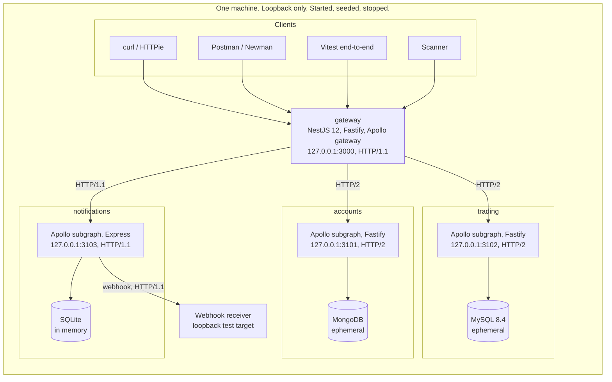
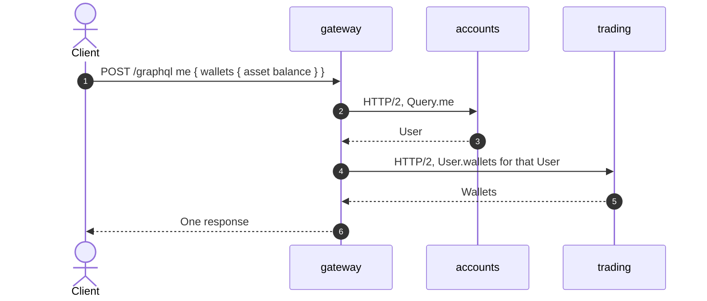
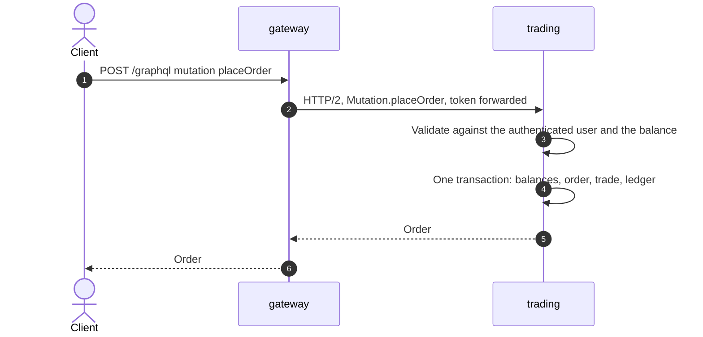
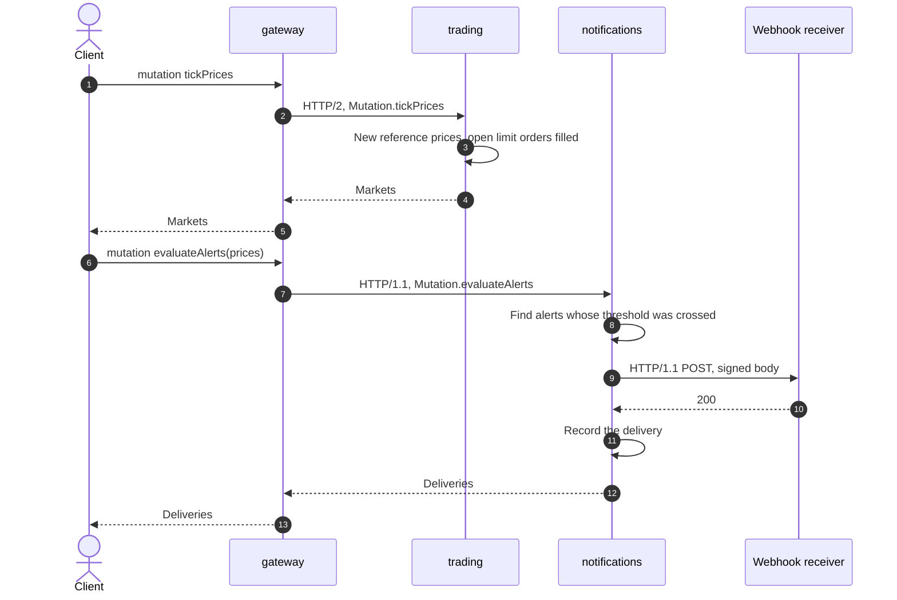

# Architecture — project

**Status:** revised on 2026-11-26 after review by the Project Owner. The gateway-on-Fastify questions were answered by a spike the same day.

## 1. What this system is

Zazzles Exchange is a **short-lived sample application**. It is started, preloaded with fake data, exercised by a test, a scanner or a person, and shut down. Nothing in it is meant to survive: there is no data worth keeping, no user depending on it, and no deployment.

That single fact drives most of the design below, so it is worth stating what follows from it.

| Because the application is ephemeral | The architecture |
| --- | --- |
| Has no data worth keeping | Uses stores that are discarded on shutdown. No migrations, no backups, no durability settings |
| Is exercised by destructive exploits | Treats every store as disposable. A dropped table or an overdrawn wallet is undone by a reset or a restart |
| Must give a scanner the same target every time | Loads identical fake data at every start. Given the same input sequence, every run behaves the same |
| Should start with nothing to install | Starts its own database engines. No external database, no broker, no container |
| Exists to be read by scanners | Keeps the code small, idiomatic and free of infrastructure noise, so a finding points at the pattern and not at plumbing |
| Has no operator | Has no retries, reconciliation, caching layer, message broker, metrics or tracing |

What the architecture does **not** aim for: uptime, durability, horizontal scale, graceful degradation, zero-downtime changes, secret rotation. If a concern only matters for an application that stays up, it is out of scope.

What it still does, and why:

- **Binds to loopback only.** Several scenarios execute code on the host.
- **Shuts its database processes down cleanly.** Ephemeral means nothing is left behind.
- **Writes its functional baseline safely.** A protected counterpart has to be a real, working pattern.

The lifecycle:

| Step | What happens |
| --- | --- |
| Start | One command starts `accounts`, `trading` and `notifications`. Each starts its store and loads the fake data. Then `gateway` starts and composes the graph |
| Use | Tests, a scanner, or a person with curl or Postman call the gateway. `POST /api/v1/lab/reset` returns every store to its fake data at any time |
| Stop | All four processes stop, the database processes stop, their temporary data is deleted. The machine is as it was |

The reasoning for the stores is in [data-architecture.md](data-architecture.md#2-why-the-stores-are-ephemeral), and recorded in [ADR-004](decisions/ADR-004-ephemeral-stores.md).

## 2. Context and constraints

The system runs on one machine. Its shape follows from the constraints in the [project plan](../project/project-plan.md#5-constraints-and-assumptions):

- NestJS, TypeScript, TypeORM. The Fastify adapter for most processes; the Express adapter for one service.
- GraphQL federation between the services, and HTTP/2 wherever both ends can speak it.
- One gateway that is the only public listener, and three backend services at most.
- One service on MongoDB in memory, another on MySQL in memory, because the whole application is ephemeral.
- **Services do not call each other**, so that each can be built and tested alone.
- Every deliberate weakness must be reachable by a test, and must have a protected counterpart.

## 3. System context

A star. The arrows from clients to the gateway are the only ones a client can initiate. The three arrows from the gateway are the only ones between processes. No service has an arrow to another service.

## 4. Services

| Service | Workspace and package | Adapter | Owns | Store | Listener |
| --- | --- | --- | --- | --- | --- |
| `gateway` | `apps/gateway`, `@zazzles/exchange-gateway` | Fastify | The composed GraphQL schema, REST pass-through, its own status and diagnostics endpoints, health, reset fan-out | none | `127.0.0.1:3000`, HTTP/1.1 |
| `accounts` | `apps/accounts`, `@zazzles/exchange-accounts` | Fastify | Users, passwords, sessions, profile, preferences, documents | MongoDB, ephemeral | `127.0.0.1:3101`, HTTP/2 |
| `trading` | `apps/trading`, `@zazzles/exchange-trading` | Fastify | Markets, prices, wallets, the ledger, deposits, withdrawals, orders, trades, reports | MySQL, ephemeral | `127.0.0.1:3102`, HTTP/2 |
| `notifications` | `apps/notifications`, `@zazzles/exchange-notifications` | Express | Alerts, webhook deliveries, announcements, webhook settings | SQLite, in memory | `127.0.0.1:3103`, HTTP/1.1 |

Each service is a separate NestJS application with its own `package.json`, `nest-cli.json`, tests and build. They share code only through the libraries under `libs/`. The contract of each one is its [service specification](../project/services/README.md).

### Why services do not call each other

The first draft had two calls between services: `trading` asked `accounts` to hold and settle funds, and told `notifications` to evaluate alerts. Both are gone, at the Project Owner's preference for a simpler lab.

- **Each service is built and tested alone.** A test starts one service with its own store and calls it directly. Four sub-agents can build four services in parallel without touching each other's code.
- **It is federation's own model.** Apollo's design is that services never call each other; the gateway joins their data.
- **No weakness is lost.** The trust-boundary scenarios — an internal endpoint that trusts an identity header, a backend reachable directly, request forgery into a backend port — all live at the boundary between the gateway and a service.

Two changes paid for it. Wallets moved from `accounts` to `trading`, so that placing an order needs one service. Alert evaluation became a call the client makes after a price tick. See [ADR-010](decisions/ADR-010-services-never-call-each-other.md).

### Why three backend services and not two

Two would meet the constraint. The third, `notifications`, exists because it gives three weakness families a real home. A service whose job is to call a URL the user chose and to render text the user wrote is where request forgery, template injection and command injection belong. In `accounts` they would be contrived. It also makes `User.alerts` a second extension of the same entity, through the gateway.

### Why one service uses Express

The Project Owner allowed one backend service to use the Express adapter. The lab takes the option, for scanner coverage: most NestJS applications run on Express, and the two adapters have different idioms for the same job. `notifications` is the one, so that the gateway and the two Fastify services keep HTTP/2 between them. For a sample application the cost is nil. See [ADR-006](decisions/ADR-006-express-adapter-for-notifications.md).

### Why these stores

| Service | Store | Why |
| --- | --- | --- |
| `accounts` | MongoDB, ephemeral | Required. Document shape suits users, and it carries the NoSQL injection family |
| `trading` | MySQL, ephemeral | Required. Relational shape suits orders and trades, a transaction for matching, and it carries the SQL injection family |
| `notifications` | SQLite, in memory | No process to start and no download. A third TypeORM driver for the price of nothing |

## 5. Communication at a glance

| Path | Protocol | Who initiates | Carries |
| --- | --- | --- | --- |
| Client → gateway | HTTP/1.1 | Client | `POST /graphql`; REST under `/api/v1`; the OpenAPI document |
| Gateway → `accounts`, → `trading` | HTTP/2, cleartext | Gateway | Subgraph fetches and `/internal/*` calls |
| Gateway → `notifications` | HTTP/1.1 | Gateway | The same, to the one Express service |
| `notifications` → webhook | HTTP/1.1 | `notifications` | Signed deliveries, to a URL a user chose |

The edge speaks HTTP/1.1 because curl, Postman, Newman and Burp negotiate HTTP/2 only over TLS, and the lab has no TLS. Every Fastify service speaks HTTP/2. The Express service cannot: NestJS's Express adapter creates an HTTP/1.1 server, so it speaks HTTP/1.1, and so does the gateway when it calls that service.

Details: [service-communication.md](service-communication.md).

## 6. Data ownership

| Data | Owner | Others see it |
| --- | --- | --- |
| Users, passwords, sessions, roles, preferences, documents | `accounts` | Through the `User` entity of the graph |
| Markets, prices, wallets, the ledger, orders, trades, reports | `trading` | Through the graph, as fields on `User` |
| Alerts, deliveries, announcements, webhook settings | `notifications` | Through the graph, as fields on `User` |

No store is shared, and no service reads another's store. Details: [data-architecture.md](data-architecture.md).

## 7. Cross-cutting concerns

Only what a short-lived sample needs.

### Configuration

Each service loads its configuration with `@nestjs/config` and checks it at start. A missing value stops the service before it listens.

| Variable | Used by | Default |
| --- | --- | --- |
| `GATEWAY_PORT` | `gateway` | `3000` |
| `ACCOUNTS_PORT`, `TRADING_PORT`, `NOTIFICATIONS_PORT` | the three services | `3101`, `3102`, `3103` |
| `JWT_SECRET` | every service | none. Required |
| `INTERNAL_SERVICE_TOKEN` | every service | none. Required for the gateway's system calls |
| `WEBHOOK_ALLOWED_ORIGINS` | `notifications` | `http://127.0.0.1:4010`: the test receiver |
| `PARTNER_ORIGINS`, `REDIRECT_ORIGINS` | `gateway` | The test receiver's origin |

No secret is written to the repository in the functional baseline. `pnpm start` generates a random `JWT_SECRET` and `INTERNAL_SERVICE_TOKEN` for each run and passes them to all four processes. Tests do the same.

### Authentication and authorization

- **Tokens.** An HS256 access token with the claims `sub`, `sid` and `role`. Each token belongs to a session record in `accounts`, which sign-out revokes.
- **Every service verifies for itself.** The gateway forwards the bearer token or the session cookie and each service verifies it with the same secret.
- **Authorization in NestJS terms.** A global authentication guard, an `@Public()` marker for the few open operations, an `@Roles()` decorator with a roles guard, and ownership checks inside services.
- **Calls from the gateway.** Made on a user's behalf, a call forwards that user's token. Made on the system's behalf, it presents `x-internal-token`.

The patterns are chosen in [ADR-007](decisions/ADR-007-auth-and-validation-patterns.md).

### Developer conveniences are on

Because the application runs locally for minutes, the gateway serves what a developer wants: GraphQL introspection, the GraphiQL IDE, batched GraphQL requests, and the OpenAPI document at `/docs`. These are deliberate weaknesses of the lab's default configuration. They are scenarios GQL-001 to 004 and CONFIG-003.

### Logging and errors

- Logs go through the NestJS `Logger`. The functional baseline never logs a password or a token.
- REST errors use the NestJS shape `{ statusCode, message, error }`. GraphQL errors carry `extensions.code`. A stack trace stays on the server, except where a scenario returns it on purpose.

### Process lifecycle

- A service starts its store when it boots, loads the fake data, and stops the store in `onApplicationShutdown`.
- The launcher starts the three backend services, waits for each `/internal/health`, then starts `gateway`. On exit it stops all four and waits for the database processes to end.
- `POST /api/v1/lab/reset` calls `/internal/lab/reset` on every service.

### Telemetry

None. NestJS Observe is not installed.

## 8. The important flows

### 8.1 A federated query that crosses services

`me { wallets { asset balance } orders { id user { displayName } } }` needs `accounts` and `trading`. The gateway plans the query from the composed schema and calls each subgraph for the fields it owns. Neither service knows the other exists.

### 8.2 Placing an order

One service. The gateway forwards the mutation; `trading` does the rest against its own store.

### 8.3 A price tick, then the alerts

Two calls, made by the client. The first moves the prices. The second asks `notifications` to evaluate alerts against them.

### 8.4 Reset

1. The client calls `POST /api/v1/lab/reset` on the gateway. It is open by design; it is lab tooling.
2. The gateway calls `/internal/lab/reset` on every service.
3. Each service empties its own store and loads the fake data again.
4. The gateway answers with the status of each service.

## 9. Decisions

| Record | Decision |
| --- | --- |
| [ADR-001](decisions/ADR-001-pnpm-workspace-monorepo.md) | One repository, a pnpm workspace, one package per service |
| [ADR-002](decisions/ADR-002-apollo-federation-2-gateway.md) | Apollo Federation 2 with the `ApolloGatewayDriver`, not Mercurius |
| [ADR-003](decisions/ADR-003-http2-inside-http1-elsewhere.md) | HTTP/2 cleartext between the Fastify processes, HTTP/1.1 at the edge and to the Express service |
| [ADR-004](decisions/ADR-004-ephemeral-stores.md) | Ephemeral stores, because the application is started, seeded and stopped |
| [ADR-005](decisions/ADR-005-three-services-one-store-each.md) | Three backend services, each the only user of its store |
| [ADR-006](decisions/ADR-006-express-adapter-for-notifications.md) | The `notifications` service uses the Express adapter |
| [ADR-007](decisions/ADR-007-auth-and-validation-patterns.md) | Established authentication and validation patterns |
| [ADR-008](decisions/ADR-008-safe-baseline-then-deliberate-flaws.md) | Safe functional baseline first, deliberate flaws as twin operations, about two safe for every vulnerable one |
| [ADR-009](decisions/ADR-009-vulnerable-pins-one-workspace.md) | Vulnerable pins, one workspace each, guarded by an audit snapshot |
| [ADR-010](decisions/ADR-010-services-never-call-each-other.md) | Services never call each other. The gateway and the client orchestrate |

## 10. Risks and open questions

| ID | Risk or question | State |
| --- | --- | --- |
| T1 | The Apollo gateway on the Fastify adapter, with a data source that speaks HTTP/2 | **Verified** by the spike of 2026-11-26 |
| T3 | HTTP/2 on `FastifyAdapter({ http2: true })`, with Apollo mounted | **Verified** by the same spike: every gateway request arrived as `HTTP/2.0` |
| T6 | An Apollo subgraph on the Express adapter | **Verified** by the same spike |
| T2 | TypeORM's MongoDB support is basic by its own description. The `accounts` entities may need more than it offers | Open. Scaffolding proves it with one real entity |
| T4 | Starting `mysqld` on a cold cache may exceed a test timeout | Open. Scaffolding measures it |
| T7 | The code-first GraphQL generator with TypeScript 6. The spike used schema-first definitions | Open. Scaffolding finds out first |
| T5 | NestJS 12 is weeks old. A minor release between steps may change behaviour | Every step re-checks versions at its start |
| Q1 | Which service uses the Express adapter. The Project Owner likes the design; the choice of `notifications` has not been confirmed | Open. Default `notifications` |
