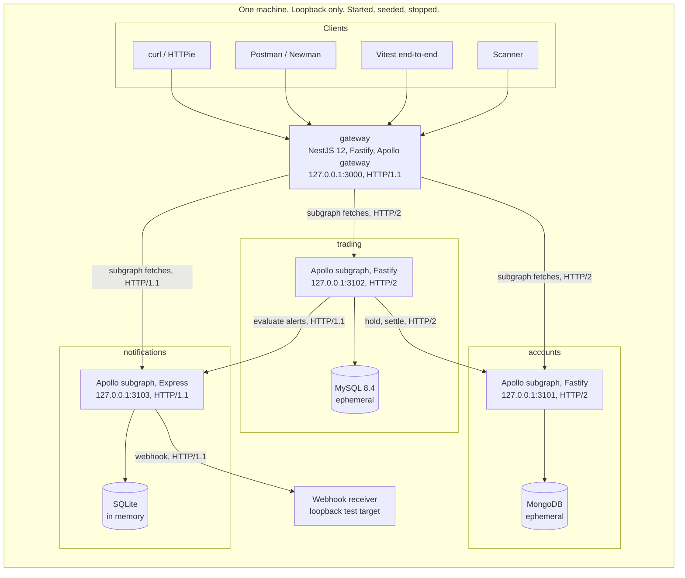
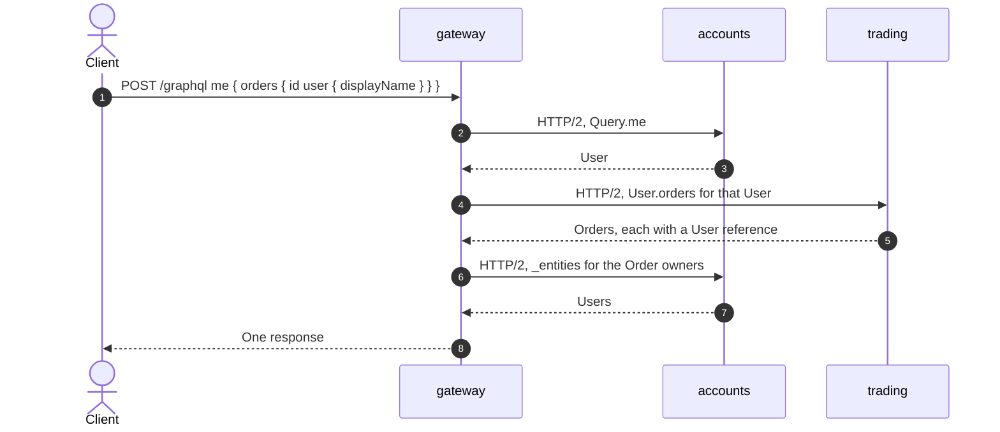
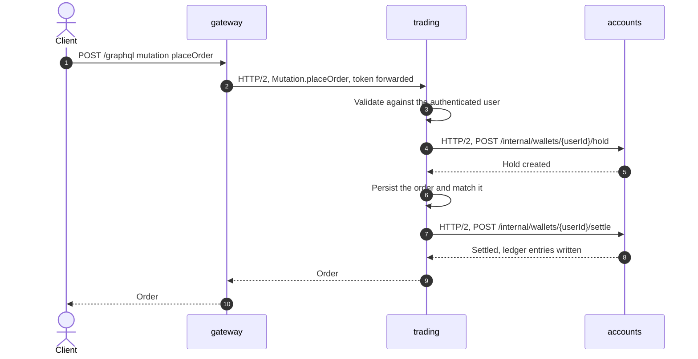
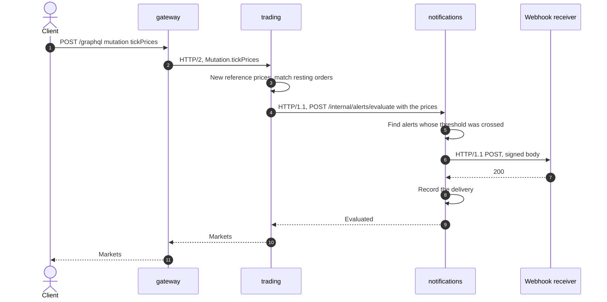

# Architecture — project

**Status:** proposed in Phase 0, waiting for review. Phase 1 proves the parts marked *unverified*.

## 1. What this system is

Zazzles Exchange is a **short-lived sample application**. It is started, preloaded with fake data, exercised by a test, a scanner or a person, and shut down. Nothing in it is meant to survive: there is no data worth keeping, no user depending on it, and no deployment.

That single fact drives most of the design below, so it is worth stating what follows from it.

| Because the application is ephemeral | The architecture |
| --- | --- |
| Has no data worth keeping | Uses stores that are discarded on shutdown. No migrations, no backups, no durability settings |
| Is exercised by destructive exploits | Treats every store as disposable. A dropped table or an overdrawn wallet is undone by a reset or a restart |
| Must give a scanner the same target every time | Seeds identical fake data at every start. Given the same input sequence, every run behaves the same |
| Should start with nothing to install | Starts its own database engines. No external database, no broker, no container |
| Exists to be read by scanners | Keeps the code small, idiomatic and free of infrastructure noise, so a finding points at the pattern and not at plumbing |
| Has no operator | Has no retries, reconciliation, caching layer, message broker, metrics or tracing |

What the architecture does **not** aim for: uptime, durability, horizontal scale, graceful degradation, zero-downtime changes, secret rotation. If a concern only matters for an application that stays up, it is out of scope.

What it still does, and why:

- **Binds to loopback only.** Several scenarios execute code on the host.
- **Shuts its database processes down cleanly.** Ephemeral means nothing is left behind.
- **Writes its functional baseline safely.** A protected counterpart has to be a real, working pattern.

The lifecycle:

| Step | What happens |
| --- | --- |
| Start | One command starts `accounts`, `trading` and `notifications`. Each starts its store and loads the fake data. Then `gateway` starts and composes the graph |
| Use | Tests, a scanner, or a person with curl or Postman call the gateway. `POST /api/v1/lab/reset` returns every store to its fake data at any time |
| Stop | All four processes stop, the database processes stop, their temporary data is deleted. The machine is as it was |

The reasoning for the stores is in [data-architecture.md](data-architecture.md#2-why-the-stores-are-ephemeral), and recorded in [ADR-004](decisions/ADR-004-ephemeral-stores.md).

## 2. Context and constraints

The system runs on one machine. Its shape follows from the constraints in the [project plan](../project/project-plan.md#5-constraints-and-assumptions):

- NestJS, TypeScript, TypeORM. The Fastify adapter for the gateway and for most services; one backend service may use the Express adapter instead.
- GraphQL federation between services, and HTTP/2 between services.
- One gateway that is the only public listener, and three backend services at most.
- One service on MongoDB in memory, another on MySQL in memory, because the whole application is ephemeral.
- Every deliberate weakness must be reachable through the gateway by a test.

A consequence worth stating: the vulnerabilities need the services to be *separate processes with real network hops*, because several of them are about the hops — a forged identity header, a request-forgery payload that reaches an internal port, a subgraph called without the gateway.

## 3. System context

The arrows from clients to the gateway are the only ones a client can initiate. Every other arrow starts inside the machine.

## 4. Services

| Service | Workspace and package | Adapter | Owns | Store | Listener |
| --- | --- | --- | --- | --- | --- |
| `gateway` | `apps/gateway`, `@zazzles/exchange-gateway` | Fastify | The composed GraphQL schema, REST pass-through, the OpenAPI document, health, reset fan-out | none | `127.0.0.1:3000`, HTTP/1.1 |
| `accounts` | `apps/accounts`, `@zazzles/exchange-accounts` | Fastify | Users, sessions, wallets, the ledger, profile documents | MongoDB, ephemeral | `127.0.0.1:3101`, HTTP/2 |
| `trading` | `apps/trading`, `@zazzles/exchange-trading` | Fastify | Markets, orders, the order book, trades, price ticks, reports | MySQL, ephemeral | `127.0.0.1:3102`, HTTP/2 |
| `notifications` | `apps/notifications`, `@zazzles/exchange-notifications` | Express | Alerts, deliveries, announcements | SQLite, in memory | `127.0.0.1:3103`, HTTP/1.1 |

Each service is a separate NestJS application with its own `package.json`, `nest-cli.json`, tests and build. They share code only through the libraries under `libs/`. See [repository-layout.md](repository-layout.md).

### Why three backend services and not two

Two would meet the constraint: identity and money in `accounts`, everything else in `trading`. The third exists for two reasons.

- **It gives three weakness families a real home.** A service whose job is to call a URL the user chose and to render text the user wrote is where request forgery (SSRF-001 to 003), template injection (DESER-003) and command injection (OS-001, 002) belong naturally. In `accounts` they would be contrived.
- **It exercises a third call direction.** With two services every internal call goes through the gateway or from `trading` to `accounts`. With three, `trading` also calls `notifications`, and `User.alerts` is a second entity extension of the same type across a different pair of services.

If the Project Owner prefers two services (open question Q2 in the plan), Phase 4 and those scenarios are dropped and nothing else changes.

### Why one service uses Express

The Project Owner allowed one backend service to use the Express adapter instead of Fastify. The lab takes the option, for scanner coverage.

- **Most NestJS applications in production run on Express**, because it is the adapter NestJS uses by default. A scanner that is tested only against Fastify is tested against the minority.
- **The two adapters have different idioms for the same job.** Fastify has hooks, `FastifyReply`, and JSON-schema route validation. Express has middleware, `res.render`, `res.cookie`, and `Multer`. Each has its own patterns for a scanner to recognize.
- **For a sample application the cost is nil.** Nothing has to stay compatible or supported. One more adapter is one more thing the code shows.

`notifications` is the one. It keeps the gateway, and the money path between `trading` and `accounts`, on Fastify with HTTP/2 between them, as the plan was first asked for. See [ADR-006](decisions/ADR-006-express-adapter-for-notifications.md).

### Why these stores

| Service | Store | Why |
| --- | --- | --- |
| `accounts` | MongoDB, ephemeral | Required. Document shape suits users and wallets, and it carries the NoSQL injection family |
| `trading` | MySQL, ephemeral | Required. Relational shape suits orders and trades, transactions for matching, and it carries the SQL injection family |
| `notifications` | SQLite, in memory | No process to start and no download. A third TypeORM driver for the price of nothing |

## 5. Communication at a glance

| Path | Protocol | Who initiates | Carries |
| --- | --- | --- | --- |
| Client → gateway | HTTP/1.1 | Client | `POST /graphql`; REST under `/api/v1`; the OpenAPI document |
| Gateway → `accounts`, → `trading` | HTTP/2, cleartext | Gateway | Subgraph fetches for the graph; `/internal/*` calls for REST pass-through |
| Gateway → `notifications` | HTTP/1.1 | Gateway | The same, to the one Express service |
| `trading` → `accounts` | HTTP/2, cleartext | `trading` | Wallet hold and settle |
| `trading` → `notifications` | HTTP/1.1 | `trading` | Evaluate alerts after a price tick |
| `notifications` → webhook | HTTP/1.1 | `notifications` | Signed deliveries, to whatever URL it was given |

The edge speaks HTTP/1.1 because curl, Postman, Newman and Burp negotiate HTTP/2 only over TLS, and the lab has no TLS. Every Fastify service speaks HTTP/2. The Express service cannot: NestJS's Express adapter has no cleartext HTTP/2, so it speaks HTTP/1.1, and its callers do the same for it.

Details: [service-communication.md](service-communication.md).

## 6. Data ownership

| Data | Owner | Others see it |
| --- | --- | --- |
| Users, passwords, sessions, roles | `accounts` | Through the `User` entity of the graph, or an internal call |
| Wallet balances, the ledger | `accounts` | `trading` asks for a hold or a settle; it never stores a balance |
| Markets, reference prices | `trading` | Through the graph; pushed to `notifications` on a tick |
| Orders, trades | `trading` | Through the graph; `User.orders` joins them to `accounts` |
| Alerts, deliveries, announcements | `notifications` | Through the graph |

No store is shared between services. Details: [data-architecture.md](data-architecture.md).

## 7. Cross-cutting concerns

Only what a short-lived sample needs.

### Configuration

Each service loads its configuration with `@nestjs/config` and checks it at start. A missing value stops the service before it listens.

| Variable | Used by | Default |
| --- | --- | --- |
| `GATEWAY_PORT` | `gateway` | `3000` |
| `ACCOUNTS_PORT`, `TRADING_PORT`, `NOTIFICATIONS_PORT` | the three services | `3101`, `3102`, `3103` |
| `JWT_SECRET` | every service | none. Required |
| `INTERNAL_SERVICE_TOKEN` | every service | none. Required for calls between services |

No secret is written to the repository in the functional baseline. `pnpm start` generates a random `JWT_SECRET` and `INTERNAL_SERVICE_TOKEN` for each run and passes them to all four processes. Tests do the same.

### Authentication and authorization

- **Tokens.** An HS256 access token that lives 15 minutes, and a refresh token stored in `accounts` and deleted on sign-out.
- **Every service verifies for itself.** The gateway forwards the bearer token and each service verifies it with the same secret. A service does not trust the gateway for identity.
- **Authorization in NestJS terms.** A global authentication guard, an `@Public()` marker for the few open operations, an `@Roles()` decorator with a roles guard, and ownership checks inside services.
- **Calls between services.** A call made on a user's behalf forwards that user's token. A call made on the system's behalf presents `x-internal-token`.

The patterns are chosen in [ADR-007](decisions/ADR-007-auth-and-validation-patterns.md).

### Developer conveniences are on

Because the application runs locally for minutes, the gateway serves what a developer wants: GraphQL introspection, the GraphiQL IDE, and the OpenAPI document at `/docs`. These are deliberate weaknesses of the lab's default configuration, not oversights. Phase 8 registers them as scenarios (GQL-001, CONFIG-003).

### Logging and errors

- Logs go through the NestJS `Logger`. The functional baseline never logs a password or a token.
- REST errors use the NestJS shape `{ statusCode, message, error }`. GraphQL errors carry `extensions.code`. A stack trace stays on the server.

### Process lifecycle

- A service starts its store when it boots, loads the fake data, and stops the store in `onApplicationShutdown`.
- The launcher starts the three backend services, waits for each `/internal/health`, then starts `gateway`. On exit it stops all four and waits for the database processes to end.
- `POST /api/v1/lab/reset` calls `/internal/lab/reset` on every service.

### Telemetry

None. NestJS Observe is not installed.

## 8. The important flows

### 8.1 A federated query that crosses services

`me { orders { id user { displayName } } }` needs three services. The gateway plans the query from the composed schema and calls each subgraph for the fields it owns.

### 8.2 Placing an order

### 8.3 A price tick fires an alert

### 8.4 Reset

1. The client calls `POST /api/v1/lab/reset` on the gateway. It is open by design; it is lab tooling.
2. The gateway calls `/internal/lab/reset` on every service.
3. Each service empties its own store and loads the fake data again from the same seed module its boot uses.
4. The gateway answers with the status of each service.

## 9. Decisions

| Record | Decision |
| --- | --- |
| [ADR-001](decisions/ADR-001-pnpm-workspace-monorepo.md) | One repository, a pnpm workspace, one package per service |
| [ADR-002](decisions/ADR-002-apollo-federation-2-gateway.md) | Apollo Federation 2 with the `ApolloGatewayDriver`, not Mercurius |
| [ADR-003](decisions/ADR-003-http2-inside-http1-elsewhere.md) | HTTP/2 cleartext between the Fastify services, HTTP/1.1 at the edge and to the Express service |
| [ADR-004](decisions/ADR-004-ephemeral-stores.md) | Ephemeral stores, because the application is started, seeded and stopped |
| [ADR-005](decisions/ADR-005-three-services-one-store-each.md) | Three backend services, each the only user of its store |
| [ADR-006](decisions/ADR-006-express-adapter-for-notifications.md) | The `notifications` service uses the Express adapter |
| [ADR-007](decisions/ADR-007-auth-and-validation-patterns.md) | Established authentication and validation patterns |
| [ADR-008](decisions/ADR-008-safe-baseline-then-deliberate-flaws.md) | Safe functional baseline first, deliberate flaws as twin operations |
| [ADR-009](decisions/ADR-009-vulnerable-pins-one-workspace.md) | Vulnerable pins, one workspace each, guarded by an audit snapshot |

## 10. Risks and open questions

| ID | Risk | First checked in |
| --- | --- | --- |
| T1 | The Apollo gateway has not been run here on the Fastify adapter with an HTTP/2 fetcher. The typings and the documentation say it works (*unverified*) | Phase 1, first |
| T2 | TypeORM's MongoDB support is basic by its own description. The `accounts` entities may need more than it offers | Phase 1, with one real entity |
| T3 | HTTP/2 on the Fastify adapter (`http2: true`) has not been run here either (*unverified*) | Phase 1 |
| T4 | Starting `mysqld` on a cold cache may exceed a test timeout | Phase 1 |
| T5 | NestJS 12 is weeks old. A minor release between phases may change behaviour | Every phase, at its start |
| T6 | The Express service's Apollo subgraph uses `@as-integrations/express5`. That integration has not been run here (*unverified*) | Phase 1 |
| Q1 | Is the `notifications` service wanted? (Plan Q2) | Before Phase 1's specification |
| Q2 | Is `notifications` the right service for Express? (Plan Q9) | Before Phase 1's specification |
| Q3 | Which authentication and validation patterns? (Plan Q4) | Before Phase 2's specification |
