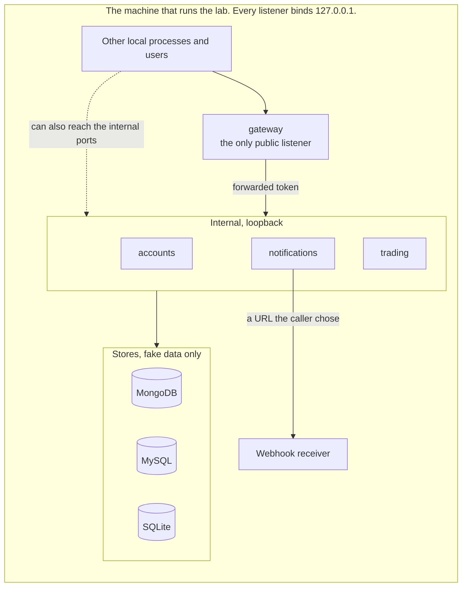

# Security model

**Status:** revised on 2026-11-26.

## 1. Two kinds of safety

This repository needs a security model for two different things, and they pull in opposite directions.

- **The lab is dangerous on purpose.** The application inside it contains deliberate weaknesses, and some of them execute code on the machine that runs it.
- **The machine and the repository must stay safe.** Nothing real may be reachable, readable or lost when a scenario is exploited.

So the model has two layers: **safety rails**, which protect the machine and never change, and **the application's own security**, which is written correctly in every safe operation and then deliberately broken in specific, labelled places.

A third fact shapes both layers: the application is a sample that is started, preloaded with fake data, exercised, and stopped. There is nothing to steal and nothing to keep. That is why the safety rails can be so few, and why the baseline does not bother with anything that only matters for an application that stays up.

## 2. Trust boundaries

| Boundary | What crosses it | What protects it in the functional baseline |
| --- | --- | --- |
| Machine → gateway | Requests from any local process or user | Authentication and authorization on every operation that needs them |
| Gateway → backend service | Subgraph fetches and internal REST calls | The forwarded token, verified again by the service. The service token for system calls |
| Local process → backend service, directly | Anything. Nothing stops a local caller from skipping the gateway | Nothing can. A service authenticates every request the same way. What a direct caller gains is the federation endpoints, `_entities` and `_service`, which the gateway keeps out of the public schema: with `_entities` it reads any user by key. This is scenario GQL-007 |
| Service → store | Queries built by the service | Parameter binding and typed filters |
| `notifications` → webhook URL | A request to a URL the caller chose | An allowlist: loopback only, no redirects |
| Machine → outside | The two database binary downloads, once | Nothing else is initiated by the lab |

## 3. Safety rails

These are invariants. They are never weakened for a scenario.

| Rail | Rule |
| --- | --- |
| Loopback only | Every listener binds `127.0.0.1`. Nothing listens on another interface, ever |
| Fake data | No real names, emails, keys, cards or files. The seed modules are the only source of data |
| Harmless markers | An exploit proves itself with `42`, `zazzles-lab-marker`, or arithmetic. Never with a real file, a real secret, or a request to a host that is not loopback |
| No real secrets | The start command generates the tokens a run needs. Nothing sensitive is on the machine that runs the lab |
| No telemetry | Nothing reports anywhere |

## 4. The functional baseline

Step 2 writes every safe operation correctly, before any vulnerable one. The safe operations are the protected counterparts of the scenarios, so they have to be real patterns and not straw men.

| Concern | How the baseline does it |
| --- | --- |
| Passwords | scrypt through Node's `crypto`, with a per-user salt |
| Tokens | HS256 JWT, verified by each service. Each token belongs to a session record, which sign-out revokes |
| Authentication | A global guard. Open operations are marked `@Public()` and each one is listed in the specification that adds it |
| Authorization | `@Roles()` with a roles guard for administration. An ownership check inside the service for anything read or changed by `id` or `userId` |
| Input validation | `@InputType()` and DTO classes with class-validator, through a global `ValidationPipe` that rejects unknown properties |
| MongoDB access | Typed, allowlisted filter objects built field by field. Never a request object used as a filter, a sort, a projection or an update |
| Untrusted objects | No dotted path and no deep merge touches request data. Preferences are written through typed inputs or an allowlist of names. Maps built from input have a null prototype |
| Entity references | Built from stored data, never from a caller's argument |
| MySQL access | TypeORM query builder with bound parameters. Raw SQL only with placeholders |
| Money | Integer minor units. Positive amounts enforced before any balance changes |
| Balance changes | One conditional update per change, so a balance can never go below zero and a race has no window |
| Outbound requests | A URL allowlist: `http` or `https`, a host that resolves to loopback, redirects not followed, a timeout |
| Files | An allowlisted name or a generated name, resolved under a fixed directory and checked to stay inside it. Uploads limited by size and extension |
| HTML | Rendered from fixed templates, with user data passed as data |
| Errors | Masked. A stack trace is logged, not returned |
| Secrets | From the environment, generated per run. Never in source |
| Logging | Through the NestJS `Logger`. No passwords, tokens or full request bodies |
| Security headers | `@fastify/helmet` at the gateway |

## 5. How a deliberate flaw is added

In Step 2, after the safe operations of its service exist, a weakness enters the code in one of two ways.

### As a twin operation

For everything with a source line to point at.

1. The functional operation stays as it is. It is the protected counterpart.
2. A twin is added in a **separate file**, with a feature-plausible name: where `deposit` checks the caller's role, a `creditWallet` convenience operation does not.
3. The vulnerable line carries a marker: `// ACCESS-003 / CWE-862: no role check`.
4. The twin is registered in `catalog/catalog.json` with its counterpart, its source path, its flow and its tests.
5. One test sends the identical payload to both and asserts the exploit succeeds on the twin and stays inert on the counterpart.
6. The documentation module for the scenario is written, with a reproduction that was run before it was written down.
7. The snapshots are regenerated in the same commit.

### As a configuration value

For process-wide settings, which have no twin.

1. The setting is changed in the small options file that owns it, with a marker on the line.
2. The documentation records the hardened value next to the weak one.
3. The test asserts the exploit. There is no counterpart test, because the application cannot run both settings at once.

The gateway leaves four settings weak on purpose: introspection, GraphiQL and the OpenAPI document are served, and batched GraphQL requests are accepted. A local sample has no reason to turn them off. They are registered as scenarios and marked, not added later.

## 6. Dependency pins

Step 4 pins vulnerable versions of individual libraries, one workspace at a time. The pins are chosen so that they install without running scripts, and every advisory they carry is a finding the dependency scanner must report. The list and the advisories are in [`docs/vulnerabilities/dependencies.md`](../../docs/vulnerabilities/dependencies.md); the reasoning is in [ADR-009](decisions/ADR-009-vulnerable-pins-one-workspace.md).

## 7. What this model does not cover

Because the application is ephemeral, the following are out of scope and are not weaknesses of the lab:

- Token rotation and revocation families, long-lived sessions, or what happens when a token leaks after the lab has stopped.
- Rate limits, caching, and protecting the services from each other when one is slow.
- Key rotation, backup encryption, data retention.
- Anything that depends on the application running longer than a test.

The `AUTH` family still has five scenarios, because sign-in is where a scanner expects to find weaknesses: token verification, throttling, enumeration and sign-out.

## 8. Running the lab safely

The lab is safe to run under these rules, and only under these rules.

- Run it on a machine you control, on loopback, and stop it afterwards.
- Several scenarios execute code on that machine: deserialization (`node-serialize`), `eval`, and command injection. Treat the lab process as if anyone who can reach its ports can run code on the machine, because from Step 2 on that is true for anyone who can reach `127.0.0.1`.
- Do not keep real credentials, SSH keys or sensitive files on a machine where untrusted people can reach the lab's ports.
- Do not deploy it, publish it on a network interface, or point a scenario at a host you do not own.
- Point exploit documentation at loopback addresses only.
