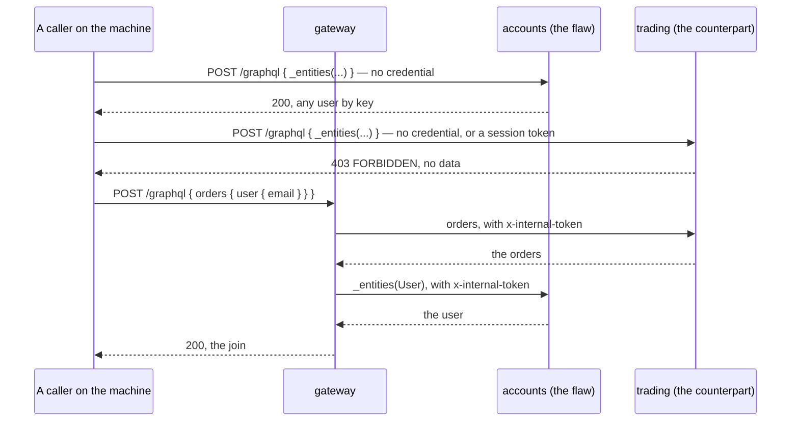

# Integration — Deliverable Specification

**Worktree / branch:** `vuln-nestjs-wt/integration` / `phase-3-integration`
**Feature:** VCX, the deliberately vulnerable NestJS lab · **Milestone:** the lab built, Steps 1 to 5 of the implementation plan
**Deliverable:** Step 3, integration: the lab as four processes, proven end to end
**Project Owner / Deliverable Owner:** the Project Owner · **Drafted:** 2026-11-28
**Delivery topology:** single-deliverable branch · **Review artifact:** one draft pull request to `main`
**Approved review shape:** one PR
**Decomposition rationale:** one pull request, because its parts prove one thing — that the four services work as one lab: the catalogue completed with the gateway's entries, the half of GQL-007 that lives in the subgraphs, the end-to-end suite and one more ground-truth check. The documentation pass over `docs/vulnerabilities/` is a sibling branch with its own pull request, because twenty modules of prose and four test files are not reviewed with the same eyes (D-8). A stack was rejected: nothing in the documentation depends on a commit of this branch after the second.
**Integration branch:** `main` · **Merge policy:** PR review required — the agent commits and pushes this branch only. The Project Owner merges, after #7 and #6
**Run log:** `.zazz/ephemeral/003-integration-run-log.md` in the worktree (ignored by Git) · **Execution tracking:** none. The pull request is the record
**Implementation coordination:** the Lead Agent, with one Contributor Agent for the end-to-end suite and one documentation agent on the sibling branch · **Companion skills:** `pr-builder`, `pr-review`, `doc-check`
**Standards:** none adopted. `AGENTS.md` stands in for the index.

**Greenlight.** The Project Owner's instruction of 2026-11-28 — to continue from the handoff and complete the implementation, testing and documentation of VCX, committing at reasonable checkpoints — is the approval to implement this step as [the plan's section 4](../project/implementation-plan.md#4-step-3--integration) and [the gateway contract's section 6](../project/services/gateway.md#6-api-tests) define it. The instruction did not settle one question, D-2: which subgraph keeps the flaw. It is taken as the invariants require, and put to the Project Owner in the pull request.

**The base of the branch.** Cut from a local merge of the tips of #6 (`e5db3dd`) and #7 (`9992636`), commit `abeab16`, not from `main`: this step cannot start from a `main` that lacks the gateway, the two branches do not conflict, and their merge is the tree `main` holds once both are merged. Until they are, the pull request's diff shows their files too; afterwards, this step's own. The scope of this step is therefore checked from `abeab16` (section 5).

---

## 0. Capability

Completes the lab as one application. The catalogue registers all 77 scenarios of the code, the gateway's thirteen last. Each real subgraph plays its part in GQL-007: accounts and notifications keep answering their federation queries to any caller, which is the flaw, and trading answers its own only to the gateway, which is the protected counterpart the running lab lacked. The end-to-end suite proves, against the real services and no stand-in, the thirteen scenarios of the gateway with their counterparts, the three scenarios of request forgery whose request reaches a sibling service, and what the gateway answers when a service behind it is gone. `pnpm scenario:check` also fails when a scenario has no request in the Postman collections. **No flaw is fixed, and none is added.**

---

## 1. Required reading

Read these before opening an editor. Section-pinned, not whole documents.

### 1.a This specification

Read it end to end first.

### 1.b Feature and milestone context

- [AGENTS.md](../../AGENTS.md): the invariants, the shared-file rule, the commands, the repo-specific rules.
- [implementation-plan.md](../project/implementation-plan.md): section 4 (this step), section 7 (the conventions of every step).
- [gateway.md](../project/services/gateway.md): section 5, the row GQL-007; section 6 (what the end-to-end layer proves).
- [accounts.md](../project/services/accounts.md), [notifications.md](../project/services/notifications.md): the rows SSRF-002, SSRF-001 and SSRF-003, and the protected counterparts each names.
- [security-model.md](../architecture/security-model.md): section 3 (the safety rails), the row "Local process → backend service, directly" of the table of callers, and section 5 (how a deliberate flaw is added).
- [testing-strategy.md](../architecture/testing-strategy.md): section 2, "End to end: four processes"; section 3 (both directions); section 4 (Postman: a request per scenario); section 5 (ground truth); section 7 (definition of done).

### 1.c Prior specifications in this effort

- [002d-gateway.md](002d-gateway.md): section 8 (the payload of each of the thirteen scenarios, to send unchanged), section 4 D-5 and section 13 (what the subgraphs need for GQL-007).
- [001-foundation.md](001-foundation.md): the end-to-end suite and the ground-truth scripts it left.

### 1.d Standards

This repository has no `standards/` directory. [AGENTS.md](../../AGENTS.md) stands in for it. **Verification step before writing code:** re-read its invariants and its repo-specific rules; they are restated in section 2 and section 5.

### 1.e Existing code to mirror

- `tests/e2e/lab.ts` — `useLab()`: one lab per file, started by the launcher's own code, stopped under four checks.
- `tests/e2e/graph.e2e-spec.ts` — the shape of an end-to-end test: the gateway's address, a token signed with the run's secret, `errorCode`.
- `apps/gateway/test/scenarios/{gql,config,edge}.int-spec.ts` — the thirteen scenarios against stand-ins. The end-to-end tests send the same payloads to the real services.
- `apps/gateway/test/subgraphs.ts` — how the stand-in plays the hardened half of GQL-007 (a 403 and a JSON error), which the real subgraphs now answer too.
- `libs/internal-auth/src/auth.guard.ts` — what `@ServiceToken()` requires of a route; the comparison it uses is now shared (`secret.ts`).

---

## 2. Invariants

The ten invariants of [AGENTS.md](../../AGENTS.md), verbatim. Those this deliverable touches most:

- **INVARIANT 1 — Never "fix" a vulnerable operation.** A test that proves a flaw stopped being exploitable is a regression: restore the flaw, do not weaken the test.
- **INVARIANT 3 — A protected counterpart is a scoped claim.** "This pattern defeats this flaw for identical input" — never "secure in general".
- **INVARIANT 4 — Every vulnerable operation has a protected counterpart**, and the lab keeps about one and a half safe operations for every vulnerable one. Where the two disagree, the counterpart is built and the ratio gives way.
- **INVARIANT 5 — Safety rails stay.** Loopback only, fake data, harmless markers (`42`, `zazzles-lab-marker`), no real credentials or files, no telemetry.
- **INVARIANT 6 — Services never call each other.** A flow that needs two services is two calls made by the client. (The scenarios of request forgery are the deliberate exception in the product; no production code of this step makes one service call another.)
- **INVARIANT 7 — Generated ground truth is never hand-edited.** Re-snapshot in the same commit as the change that justifies it.
- **INVARIANT 9 — Never document a command that has not been run.**
- **INVARIANT 10 — Names in code stay neutral.** Identifiers and paths describe the feature, not the flaw.

---

## 3. Scope

### Approved review shape

One pull request, as the header records. If implementation shows a need to split it, stop for the Project Owner's sign-off, amend this section in place and record the change in section 13.

**Rationale.** The parts depend on each other: the end-to-end test of GQL-007 is meaningless without the subgraph half, and the catalogue entry of GQL-007 names that test. Separate pull requests were rejected for that reason. The documentation pass is the one sibling, because it is reviewed as prose against code (D-8).

**Review units owned by this specification.**

- One PR — the catalogue completed, GQL-007's subgraph half with its three test layers, the end-to-end suite, the request check. Evidence boundary: the commands of section 6, each exit code read.

### Strict scope constraint

Every file this specification adds or changes is under `tests/e2e/`, `scripts/check-scenarios.{mjs,spec.ts}`, `catalog/`, the two ground-truth files under `tests/`, `libs/internal-auth/src/`, the GraphQL module of accounts and that of trading with the one plugin file beside it, the tests of trading — one new file and the four that call `_entities` — section GQL-007 of `docs/vulnerabilities/gql.md`, and this file. A file outside it stops the work (section 5).

### In scope

| Path | New / modified | Reason |
| --- | --- | --- |
| `catalog/catalog.json`, `tests/expected-hashes.json`, `tests/expected-scanner-findings.json` | modified | The gateway's thirteen entries, registered in the order of merge; the entry of GQL-007 corrected to the files that now carry the flaw and its counterparts; re-snapshotted |
| `libs/internal-auth/src/secret.ts`, `secret.spec.ts`, `auth.guard.ts`, `index.ts` | new, modified | `sameSecret`, the comparison the guard already made, moved to a file of its own and exported for the plugin, with its tests; the guard imports it |
| `apps/trading/src/graphql/federation-queries.plugin.ts` | new | The counterpart of GQL-007: an Apollo Server plugin that answers `_entities` and `_service` only to the service token |
| `apps/trading/src/graphql/graphql.module.ts` | modified | Registers the plugin: the hardened setting, with its marker |
| `apps/trading/test/federation-queries.int-spec.ts` | new | The counterpart proven in the service alone, both directions |
| `apps/trading/test/app.int-spec.ts`, `safe.int-spec.ts`, `scenarios/access.int-spec.ts`, `scenarios/graph.int-spec.ts` | modified | Their `_entities` calls present the service token, as the gateway does on every fetch. No assertion changes: with the token presented, it is the resolver that answers or refuses |


| `apps/accounts/src/graphql/graphql.module.ts` | modified | The marker of GQL-007 on the weak setting. A comment: the behaviour of accounts does not change, and nothing in `apps/notifications` changes |
| `tests/e2e/scenarios-graphql.e2e-spec.ts` | new | GQL-001 to GQL-004 and GQL-007 against the real lab |
| `tests/e2e/scenarios-config.e2e-spec.ts` | new | CONFIG-001 to CONFIG-004 against the real lab |
| `tests/e2e/scenarios-edge.e2e-spec.ts` | new | REDIR-001, XSS-003, COOKIE-003, INFO-002 against the real lab; then the gateway with trading gone |
| `tests/e2e/scenarios-ssrf.e2e-spec.ts` | new | SSRF-001, SSRF-002, SSRF-003: the request reaches a sibling service |
| `tests/e2e/scenarios.ts` | new, if two files need the same helper | Tokens of the fake users, a call over HTTP/2 cleartext, the payloads |
| `scripts/check-scenarios.mjs`, `scripts/check-scenarios.spec.ts` | modified | `pnpm scenario:check` fails when a scenario has no request under `postman/` |
| `docs/vulnerabilities/gql.md` | modified | Section GQL-007 only: the three subgraphs as built, every command in it run by the lead |
| `.zazz/specifications/003-integration.md`, `.zazz/specifications/README.md` | new, modified | This file; its row in the index |

### Out of scope

- Everything else under `docs/vulnerabilities/`: the documentation pass, sibling branch `phase-3a-vulnerability-docs`, which also makes `index.md` the table of every scenario.
- `postman/`: complete. On 2026-11-28, 152 requests, one named after each of the 77 scenarios and none without a test script; the eight pins have no request, no HTTP request showing an advisory.
- `apps/gateway/**`: the gateway's half of GQL-007 is built and reviewed (#6); its settings do not change.
- The behaviour of `apps/accounts/**`: accounts keeps the flaw (D-2).
- Dependencies nothing imports, the contracts' counts, the setup page: the cleanup pull request after this one.
- `tests/e2e/{lab,graph,transport,launcher}.e2e-spec.ts`: the scaffolding's four files prove the join of three services, the protocols, reset and the clean stop. They change only if a test of this step needs a helper of `lab.ts`.

---

## 4. Decisions

Each answers "why this over the obvious alternative?".

### D-1 — The branch starts from a local merge of #6 and #7

**Decision.** `phase-3-integration` is cut from `abeab16`, the gateway's tip with the notifications tip merged into it, and pushed at once as a draft.

**Why.** Over waiting for the merges: the Project Owner asked for the work to go on, and every hour between the two merges and this branch is an hour added to the end. Over a local-only branch rebased later: a pushed branch has CI on every push, the pre-push hook on every push and nothing to lose to the usage limit, which stopped builders twice on 2026-11-27. The merge is clean (`git merge-tree --write-tree` exits 0) and the combined tree passed the whole gate on 2026-11-28, so the base is what `main` will be.

### D-2 — Accounts and notifications keep the flaw; trading is the counterpart

**Decision.** The specification of #6 (D-5, section 13) and the handoff say each real subgraph must require the token. Built as written, no subgraph would answer a direct `_entities` call any more: the flaw would exist only in the gateway's tests, against a stand-in. Accounts and notifications keep the weak setting — the federation queries are added to their schema outside the reach of the global guard, and answer any caller — and trading registers the plugin.

**Why.** Invariant 1 forbids removing a vulnerable operation; invariant 4 requires its counterpart in the lab. The gateway contract's row designs one: "a subgraph requires it", not "each subgraph", as every other scenario has one twin. Accounts stays weak because the contract's own example is its port: a direct `_entities` call to `127.0.0.1:3101` reads any user by key, where `user(id)` is an administrator's question. Measured on 2026-11-28 with no credential at all: accounts answers `_service` with its whole schema and `_entities` with `u-admin`'s record; notifications answers `_entities` with an announcement by key. Hardening accounts and leaving another weak was rejected: the gain the scenario is about is the user's record. Of the other two, trading is the one hardened. Its `_entities` already asks for a session token, so there the hardened setting changes the most — any signed-in user becomes the gateway alone — and its tests call `_entities` in four files, where those of notifications do in six. First drafted with both hardened; changed the same day on the evidence of the gate (section 13).

### D-3 — The counterpart is an Apollo Server plugin in the subgraph's GraphQL module

**Decision.** `federationQueriesNeedTheToken(service, token)`, registered under `plugins` in the module's options. Once the operation is parsed and validated, and before any resolver runs, it refuses with a `GraphQLError` an operation that selects `_entities` or `_service` anywhere — at the root, under an alias, through a fragment — unless the request presents the internal service token.

**Why.** Over a Nest guard on declared resolvers: the two queries are not Nest resolvers. `@nestjs/graphql` builds the subgraph schema with `buildSubgraphSchema`, which adds `_service` and `_entities` itself, and Nest's global guard runs only for the handlers Nest registered (measured: accounts' `user(id)` answers `UNAUTHENTICATED` to the same request that `_entities` answers with data). Over a hook on the HTTP route: it needs the body before Apollo has it, and on the Express service it would meet `JsonBodyMiddleware`, the scenario's own parser. The plugin is a setting of the module, as the gateway's four are (002d, D-4); it is the same on both adapters; and a weak setting is proven live only by breaking it, which this makes one line to do.

### D-4 — The refusal is HTTP 403, `FORBIDDEN`, in the shape the gateway's test already asserts

**Decision.** Status 403; body `{ "errors": [{ "message": "<service> answers its federation queries to the gateway only", "extensions": { "code": "FORBIDDEN" } }] }`; no `data`.

**Why.** The specification of #6, its stand-in and its test all say 403, and `docs/vulnerabilities/gql.md` shows it. Apollo Server 5.5.2 maps a `GraphQLError`'s `extensions.http.status` onto the response (`errorNormalize.js`), and gives 500 to a pre-execution error that carries none: so the status is set in the error and nowhere else. Over the guard's 401: the caller is not unidentified; it is identified as not the gateway.

### D-5 — Four end-to-end files, by family, each with its own lab

**Decision.** `scenarios-graphql`, `scenarios-config`, `scenarios-edge`, `scenarios-ssrf`, each under 600 lines, each calling `useLab()` once.

**Why.** Over one file: a failing family then fails alone, no file crosses the review's 600-line threshold, and a file that takes the lab apart (`scenarios-edge`: trading stopped) does not take the others down with it. The cost is three more starts, about nine seconds each.

### D-6 — Request forgery is proven against a real sibling

**Decision.** SSRF-001, SSRF-002 and SSRF-003 are sent, through the gateway, with a URL that names another service of the running lab (`/internal/*` on its relay or its own port). The exploit asserts the sibling's own answer came back; each counterpart asserts why the same URL was refused.

**Why.** The services' own tests use a stand-in listener on a spare port, by the rule that a service's tests start it alone. The contract's claim is stronger — "`http://127.0.0.1:3102/internal/…` is reached from inside the machine" — and only the whole lab can show it. The testing strategy names SSRF-001 with GQL-007 as the scenarios about calling something other than the gateway.

### D-7 — "A request per scenario" becomes ground truth

**Decision.** `pnpm scenario:check` also reports, and fails on, a registered scenario with no request named after it under `postman/`: the ID at the start of a request's name, in any collection.

**Why.** The testing strategy makes it a rule and nothing checked it. In `scripts/check-scenarios.mjs` rather than in a test under `tests/api/`: the catalogue is the list of scenario IDs, and the ground-truth job of CI already runs the check. Over a check in `tests/api/collections.spec.ts`: that file guards the shape of a collection, not its coverage of the catalogue.

### D-8 — The documentation pass is a sibling, and starts after GQL-007's documentation is committed here

**Decision.** `phase-3a-vulnerability-docs` is cut from this branch's commit that completes GQL-007, with its own specification and pull request. `docs/vulnerabilities/index.md` is its work.

**Why.** Over one pull request: the documentation pass rewrites twenty modules; read beside four test files and a plugin, neither is reviewed well. Cut after the GQL-007 commit: that commit rewrites the scenario's section of `gql.md` with commands that were run, and the pass then reviews it instead of writing it twice.

---

## 5. Agent implementation rules

### Team integration

Commit and push to `phase-3-integration` only. Never merge, never commit to another branch. All integration is the Project Owner's, through the pull request, after #7 and #6 are merged.

### Command working directory

Every command runs in the worktree: `cd /Users/michael/Dev/zazzcode/vuln-nestjs-wt/integration`. Paths in file tools are under it.

### Commit and push

- One slice, one commit, pushed the moment it is green. One scenario, one commit. A documentation module is a slice of its own.
- Before every push: `pnpm lint` with its summary line read (zero warnings is the baseline), `pnpm format:check`, `pnpm test`, and the tests that cover the change, each exit code read from where it was written. The pre-push hook runs the first three and refuses the push while one stands: fix it, never push past it.
- Fifteen minutes at most between pushes.
- A commit message is written to a file and given to `git commit -F`. Nothing is chained after a check in one command: the exit code is read, then the commit.
- Pushes less than about four minutes apart cancel each other's CI run. One push per slice makes that rare; a cancelled run is not red.

### The lab's ports

`pnpm test:e2e`, `pnpm test:api` and the root `pnpm test:int` take every port of the lab (3000, 3101 to 3103, 3201, 3202). While the Contributor Agent of the end-to-end suite works, it alone runs them and it alone runs `pnpm test:e2e` file by file; the Lead Agent runs nothing on those ports and no database test elsewhere on the machine. A service's own `test:int` uses that service's port: not while a whole-lab suite runs either. `pnpm build` before `pnpm test:api`: it does not build.

### Scope verification

Until #6 and #7 are merged, `git diff origin/main...HEAD --name-only` lists their files as well. The scope of this step is `git diff abead16..HEAD --name-only`: only the paths of section 3. After the merges, both commands agree.

### Run log

`.zazz/ephemeral/003-integration-run-log.md`, append-only. A line carries the time and what came of it, and the time comes from `date` in the same command that appends: `echo "$(date '+%Y-%m-%d %H:%M') — …" >> <run log>`. Lines for: a slice started, every check with its exit code, every commit with its hash and its push, every regression check (what was removed or set, the file run, how many tests failed, the name of the exploit test among them, the restore), and "Where I stopped" before the turn ends.

### Lead Agent / Contributor Agent coordination

All code happens in the one worktree, in order, so that no two agents edit one file.

| Task | Responsible agent | Allowed scope | Required evidence |
| --- | --- | --- | --- |
| This specification; the catalogue; GQL-007's subgraph half with its service tests and its end-to-end test; the request check; section GQL-007 of `gql.md` | Lead Agent | section 3 | Each exit code in the run log; the regression checks recorded |
| The rest of the end-to-end suite: GQL-001 to GQL-004, CONFIG-001 to CONFIG-004, REDIR-001, XSS-003, COOKIE-003, INFO-002, the gateway with trading gone, SSRF-001 to SSRF-003 | One Contributor Agent (`service-builder`), after the Lead Agent's tasks above are committed and pushed | `tests/e2e/scenarios-*.e2e-spec.ts` and `tests/e2e/scenarios.ts`; its run log under `.zazz/ephemeral/` | Each file green under `pnpm test:e2e`; one scenario, one commit, one push; a report that names what it did not run |
| The documentation pass | One documentation agent on GLM 5.4, in its own worktree on the sibling branch | `docs/vulnerabilities/**`, the `documentation` field of the twenty-one entries of trading | Its own specification |
| Independent review | Two `service-reviewer`s, one per axis of `pr-review` | Nothing written but their findings file | Findings with the file and the line behind each |

The Lead Agent runs the gate after each agent reports, repeats the most important proof before trusting it, and closes or answers what the reviewers find.

### Autonomy boundaries

Hard constraints: section 3, the review shape, section 2, the acceptance criteria of section 6, the halt conditions below. Adaptive guidance: helper names, the layout inside a test file, exact assertions beyond those section 6 names.

### Halt conditions

Stop and surface to the Project Owner if:

1. A change is needed outside section 3.
2. The same automated test fails three times in a row.
3. A test proves a flaw stopped being exploitable, or stays green with its flaw removed, and the cause is not in the test.
4. `pnpm lint`, `pnpm format:check`, `pnpm test`, `pnpm test:int`, `pnpm test:e2e` or `pnpm test:api` cannot be made to exit 0.
5. A lab does not stop cleanly: a service had to be killed, or an engine or a temporary directory remained.
6. A command for `gql.md` cannot be run as it would be written.
7. The Project Owner asks for changes to #6 or #7 that touch what this branch builds on: merge `main` into this branch first.

---

## 6. Acceptance criteria

Reference data: the fake data of `@zazzles/exchange-lab-data` as every run loads it (`u-admin`, `u-alice`, `u-bob`, orders `1` and `6`, announcement `1`), the secrets of the run (`lab().secrets`), and the payloads of 002d's section 8, sent unchanged.

- **AC1 — The catalogue is complete.** `pnpm scenario:check` exits 0 with "77 of 85 designed scenarios are registered"; the eight not registered are the pins. `tests/expected-hashes.json` and `tests/expected-scanner-findings.json` were regenerated by `pnpm scenario:update` in the commits that changed the catalogue, never edited. Verified by that command, and by `git log --stat` of the commits that touch `catalog/`.
- **AC2 — Accounts and notifications still answer any caller.** A `POST /graphql` to accounts' own listener, over HTTP/2 cleartext, with no credential: `{ _service { sdl } }` answers 200 with the schema; `_entities(representations: [{__typename: "User", id: "u-admin"}])` answers 200 with `{ id: "u-admin", email: "admin@vcx.exchange", displayName: "Admin" }`; and `user(id: "u-admin")` answers `UNAUTHENTICATED`. To notifications' own listener, with no credential: `_entities` answers announcement `1` and `_service` its schema. Accounts' module carries the marker `GQL-007 / CWE-306`. Verified by `tests/e2e/scenarios-graphql.e2e-spec.ts`.
- **AC3 — Trading answers its federation queries to the gateway only.** A direct `POST /graphql` to trading: (a) `_service` and `_entities` with no credential answer 403, with `errors[0].extensions.code` `FORBIDDEN`, the message `trading answers its federation queries to the gateway only`, and no `data`; (b) the same with a plain user's session token and with an administrator's: 403; (c) `_entities` under an alias, inside an inline fragment on `Query`: 403; (d) with the run's service token: 200 and the query answered; (e) an ordinary operation of trading is answered as before. The same refusal and the same answer through its relay. Verified by `apps/trading/test/federation-queries.int-spec.ts` (the service alone) and `tests/e2e/scenarios-graphql.e2e-spec.ts` (the lab).
- **AC4 — The graph still answers.** Through the gateway, as Alice: `{ orders { id symbol user { id email displayName } } }` returns her two orders with her own record on each, which is trading's root and accounts' `_entities`; as an administrator: `{ user(id: "u-alice") { id orders { id symbol } } }`, which is the other way round; and one query with a field of each of the three services. No error in any. Verified by `tests/e2e/scenarios-graphql.e2e-spec.ts` and, for the third, the existing `tests/e2e/graph.e2e-spec.ts`.
- **AC5 — The thirteen scenarios of the gateway, end to end.** Each payload of 002d's section 8 is sent, through the gateway, to the vulnerable endpoint and to each protected counterpart of its row. The exploit assertion names what was gained, on the real service's answer; the counterpart assertion names why it was refused. In four files: GQL-001 to GQL-004 and GQL-007 in `scenarios-graphql`, CONFIG-001 to CONFIG-004 in `scenarios-config`, REDIR-001, XSS-003, COOKIE-003 and INFO-002 in `scenarios-edge`. A setting's test asserts the exploit; its hardened value is not set. Verified by `pnpm test:e2e`.
- **AC6 — Request forgery reaches a sibling.** SSRF-001, SSRF-002 and SSRF-003, each with the URL of a sibling service's `/internal/*` path: the exploit asserts that service's own answer was returned to the caller; each counterpart of the contract's row receives the identical URL and the assertion names why it was refused (`setWebhookUrl` at save time, `registerWebhook` at delivery time, the avatar allowlist, `import` which fetches nothing, `import-url` behind the guard). Verified by `tests/e2e/scenarios-ssrf.e2e-spec.ts`.
- **AC7 — The gateway with a service gone.** With trading stopped by `lab().stopService('trading')`: a REST pass-through route whose upstream is trading answers 503 in the lab's error shape, its message naming `trading`; `GET /api/v1/health` answers 503 with trading `unavailable`; and INFO-002's page answers the failure as its module shows. Verified by `tests/e2e/scenarios-edge.e2e-spec.ts`, the tests that take the lab apart running last in the file.
- **AC8 — A request per scenario is ground truth.** `pnpm scenario:check` exits 0 and its line says that 77 of 77 registered scenarios have a request under `postman/`; with one request's ID renamed in a scratch copy, it exits 1 and names the scenario. Verified by that command and by the unit test of `scripts/check-scenarios.spec.ts`.
- **AC9 — Clean, and nothing left behind.** `pnpm build`, `pnpm lint` (0 warnings, 0 errors), `pnpm format:check`, `pnpm test`, `pnpm test:int`, `pnpm test:e2e`, `pnpm test:api`, `pnpm scenario:check` and `pnpm audit:check` each exit 0 on the tip. Every end-to-end file's stop finds nothing forced and nothing left behind, which `useLab()` asserts. Verified by each exit code, read from where it was written.
- **AC10 — The documentation says what is built.** Section GQL-007 of `docs/vulnerabilities/gql.md` shows accounts and notifications answering a direct `_entities` call with no credential, trading answering 403 to the same call and 200 with the service token, and the graph still answering; every command in it was run against a lab of the lead's, on a port set of its own, and its output is what was printed. Its "vulnerable and protected" table says why each counterpart works, as a scoped claim. Verified by the run log's lines for each command, and `doc-check`'s manual pass.
- **AC11 — The counterpart is proven live.** With the `plugins` line removed from trading's module, its three refusal tests fail and pass restored. The check is a line of the run log: what was removed, the file run, how many failed, the names. Verified by the run log.
- **AC12 — Scope.** `git diff abead16..HEAD --name-only` lists only the paths of section 3. `pnpm-lock.yaml` and `tests/expected-audit.json` are unchanged: this step adds no dependency and no pin. Verified by that command.

---

## 7. Test strategy

Every test below proves an AC. Nothing is added to prove what an existing test already proves: the join of three services, the protocols, reset and the clean stop stay where they are (`graph`, `transport`, `lab`, `launcher`), and the services' own suites keep every scenario of their own.

### Automated tests

**`apps/trading/test/federation-queries.int-spec.ts`** — AC3, AC11. The service alone, as its tests start it. Five tests, each named for what it proves:

- "GQL-007, the counterpart: `_service` and `_entities` answer 403 to a call with no credential" — status, the code, the message, no `data`.
- "…to a call with a session token and no service token" — the same, for a plain user and for an administrator.
- "…where the query hides `_entities` under an alias and a fragment".
- "with the service token, both are answered" — `_service` returns the schema; `_entities` reaches the resolvers.
- "an operation that is neither is answered as before" — one public root operation, one that needs a caller.

Trading's existing tests that call `_entities` — `app.int-spec.ts`, `safe.int-spec.ts`, `scenarios/access.int-spec.ts`, `scenarios/graph.int-spec.ts` — present the service token on those calls, as the gateway does. Two of them assert a counterpart's `FORBIDDEN`; without the token they would pass on the plugin's 403 instead of the resolver's refusal, and that is what the gate showed.

**`tests/e2e/scenarios-graphql.e2e-spec.ts`** — AC2, AC3, AC4, AC5. One lab. GQL-007 against the three real subgraphs and the gateway; then GQL-001 (introspection to a caller with no token; the GraphiQL IDE to a browser), GQL-002 (the walk of twelve levels, answered with data), GQL-003 (one request, three operations, three answers), GQL-004 (a validation error carrying `extensions.stacktrace`). A setting has no twin: each test asserts the exploit and names the hardened value in the catalogue.

**`tests/e2e/scenarios-config.e2e-spec.ts`** — AC5. CONFIG-001 with its two counterparts, CONFIG-002, CONFIG-003, CONFIG-004: the payloads of 002d's section 8, the counterparts' refusals as the real trading and accounts answer them.

**`tests/e2e/scenarios-edge.e2e-spec.ts`** — AC5, AC7. REDIR-001 with `redirect: 'manual'` (the 302 and its `Location`, which Newman follows), XSS-003, COOKIE-003 (the display name changed on accounts' real profile, read back through the gateway). Last, with trading stopped: INFO-002, its two counterparts as far as a stopped lab allows, the pass-through route's 503 naming `trading`, and health.

**`tests/e2e/scenarios-ssrf.e2e-spec.ts`** — AC6. Three scenarios, each one URL sent to the vulnerable operation and to each counterpart.

**`scripts/check-scenarios.spec.ts`** — AC8. The new function: a scenario whose ID no request's name starts with is reported; one with a request is not; a request naming an ID the catalogue does not have is ignored.

**`libs/internal-auth/src/auth-guard.spec.ts`** — `sameSecret`, moved not changed: the existing service-token tests keep passing; one test each for equal, different, and different length.

Existing coverage reused: `tests/e2e/graph.e2e-spec.ts` (the join, AC4's third query), `apps/gateway/test/scenarios/*.int-spec.ts` (the thirteen against stand-ins: unchanged, they stay), `tests/api/collections.api-spec.ts` (every request passes under Newman).

Manual verification: none beyond the regression checks of AC11, which are recorded in the run log.

---

## 8. TDD entry point and execution sequence

### TDD entry point

The first failing test, in `apps/trading/test/federation-queries.int-spec.ts`:

```ts
test('GQL-007, the counterpart: _service and _entities answer 403 to a call with no credential', async () => {
  const refused = await graphqlOn(port, '{ _service { sdl } }');
  expect(refused.status).toBe(403);
  expect(refused.body.errors?.[0]?.extensions?.code).toBe('FORBIDDEN');
  expect(refused.body.data).toBeUndefined();
});
```

It fails before the plugin is registered (the service answers 200), and passes after.

### Prescriptive execution sequence

**Phase 1: The catalogue (AC1).** Register the gateway's thirteen entries as the builder wrote them: `node .zazz/ephemeral/s9-append-catalogue.mjs <worktree> <entries> --write`, `pnpm exec prettier --write catalog/catalog.json`, `pnpm scenario:update`, `pnpm scenario:check` (77 of 85). Commit the three files together. Push; open the draft pull request.

**Phase 2: GQL-007's subgraph half (AC2, AC3, AC4, AC11).**
2.1. `sameSecret` exported from `libs/internal-auth`; the guard imports it. `pnpm --filter @zazzles/exchange-internal-auth test`.
2.2. Trading: the plugin and its registration; the five tests, each failing first; the regression check of AC11, recorded.
2.3. Trading's existing tests that call `_entities` present the service token on those calls: `app.int-spec.ts`, `safe.int-spec.ts`, `scenarios/access.int-spec.ts`, `scenarios/graph.int-spec.ts`. `pnpm --filter @zazzles/exchange-trading test:int`: 120 tests.
2.4. Accounts: the marker comment, and nothing else. Its `test:int` unchanged: 146 tests. Notifications: nothing.
2.5. `tests/e2e/scenarios-graphql.e2e-spec.ts`: GQL-007 against the lab (AC2, AC3, AC4). `pnpm build && pnpm test:e2e tests/e2e/scenarios-graphql.e2e-spec.ts`.
2.6. The catalogue entry of GQL-007: `source` accounts' module, `safeControl` the gateway's data source, `safeControls` trading's module, `test` the end-to-end file, the hardened value as built; `pnpm scenario:update` in the same commit.

**Phase 3: The request check (AC8).** In `scripts/check-scenarios.mjs`: the function, its unit test, the summary line. `pnpm scenario:check`: 77 of 85, 77 with a request.

**Phase 4: Section GQL-007 of `gql.md` (AC10).** A lab on the port set 4400, 4401 to 4403, 4411, 4412; each command as the section shows it, run; the outputs as printed.

**Phase 5: The end-to-end suite (AC5, AC6, AC7).** One Contributor Agent, one scenario, one commit, one push: `scenarios-graphql` completed (GQL-001 to GQL-004), `scenarios-config`, `scenarios-edge`, `scenarios-ssrf`.

**Phase 6: The gate and the review.** Section 6's commands, each exit code read; two reviewers, one per axis; what they find closed with its proof; CI green on the tip; the body with `pr-builder`; the draft put to the Project Owner.

### Skeleton: `apps/trading/src/graphql/federation-queries.plugin.ts`

```ts
export function federationQueriesNeedTheToken(service: string, expectedToken: string): ApolloServerPlugin {
  return {
    async requestDidStart() {
      return {
        async didResolveOperation({ request, document }) {
          if (!asksForAFederationQuery(document)) return;
          const given = request.http?.headers.get(SERVICE_TOKEN_HEADER);
          if (given !== undefined && sameSecret(given, expectedToken)) return;
          throw new GraphQLError(`${service} answers its federation queries to the gateway only`, {
            extensions: { code: 'FORBIDDEN', http: { status: 403 } },
          });
        },
      };
    },
  };
}
```

### The flow of GQL-007, as built



---

## 9. Definition of done

- [ ] All of section 1 read; the invariants and the repo-specific rules of `AGENTS.md` re-read.
- [ ] D-2 confirmed by the Project Owner, or changed by them, and the change recorded in section 13.
- [ ] `pnpm build`, `pnpm lint`, `pnpm format:check`, `pnpm test`, `pnpm test:int`, `pnpm test:e2e`, `pnpm test:api`, `pnpm scenario:check`, `pnpm audit:check`: each exit 0 on the tip.
- [ ] `pnpm scenario:check`: 77 of 85 registered, 77 of 77 with a request.
- [ ] The regression checks of AC11 are lines of the run log.
- [ ] Every command of section GQL-007 in `gql.md` was run, and its lines are in the run log.
- [ ] `git diff abead16..HEAD --name-only` lists only the paths of section 3.
- [ ] The PR is one, a draft, with this specification as its first commit.
- [ ] AC1 to AC12 verified, each with the test or command that verifies it.
- [ ] The run log is current, with the Contributor Agent's outcome and a "Where I stopped".
- [ ] Two reviewers reported, one per axis; each finding closed with its proof or answered.
- [ ] CI green on the tip.
- [ ] The body links this specification and lists each AC's verification.

---

## 10. Open questions

- **OQ-1 — Which subgraph keeps the flaw of GQL-007?** Taken by the Lead Agent as D-2, on the invariants, so that the work is not held; to be confirmed by the Project Owner in the pull request. If they choose another subgraph for the flaw, the plugin moves: one line of registration, one marker, the entry's `source`, and the tests name the service.
- **OQ-2 — The package scope `@zazzles/exchange-*` with the rename to VCX.** Open with the Project Owner since 2026-11-27. Not this specification's: no package name changes here.

---

## 11. Run log protocol

`.zazz/ephemeral/003-integration-run-log.md` in the worktree: append-only, never an earlier line rewritten. Each line carries the time from `date`, in the same command that appends. Sections: the lead's phases; "The end-to-end suite" (the Contributor Agent's, with its own "Where I stopped"); "The review"; "The gate". A session that resumes starts by appending a line with the time and what it is about to read.

---

## 12. Agent implementation prompt

For the Contributor Agent of the end-to-end suite (Phase 5):

```text
You are building the end-to-end tests of Step 3 for vuln-nestjs, a deliberately vulnerable NestJS lab. The flaws are the product.
Worktree: /Users/michael/Dev/zazzcode/vuln-nestjs-wt/integration — every command and file path is inside it.
Branch: phase-3-integration. Commit and push there only. Never merge, never touch another branch or worktree.
Specification: .zazz/specifications/003-integration.md. Read AGENTS.md, then its sections 1, 2, 3, 5, 6 and 7, then tests/e2e/lab.ts and tests/e2e/scenarios-graphql.e2e-spec.ts.
You write only: tests/e2e/scenarios-graphql.e2e-spec.ts (GQL-001 to GQL-004; GQL-007 is written), tests/e2e/scenarios-config.e2e-spec.ts, tests/e2e/scenarios-edge.e2e-spec.ts, tests/e2e/scenarios-ssrf.e2e-spec.ts, tests/e2e/scenarios.ts, and your run log under .zazz/ephemeral/.
The payloads are those of .zazz/specifications/002d-gateway.md, section 8, sent unchanged through the gateway to the real services; apps/gateway/test/scenarios/*.int-spec.ts show each against a stand-in.
You alone run the whole lab's suites while you work: pnpm build, then pnpm test:e2e <file> for one file at a time. Nothing else on the machine uses the lab's ports.
One scenario, one commit, one push. Before every push: pnpm lint (read its summary line: zero warnings), pnpm format:check, pnpm test, each exit code read. A commit message goes in a file: git commit -F.
Your run log is .zazz/ephemeral/003-e2e-run-log.md: append-only, a line at every event, its time from date in the same command.
Halt on: a file outside your scope; a test that cannot be made to pass; a lab that does not stop cleanly.
Before you stop, for any reason: commit and push everything, and append "Where I stopped".
Your final report starts with the sentence of your own instructions that begins "You are powered by the model", then counts the scenarios proven end to end, of 19, and lists what you did not run.
```

The Verifier Agent's prompt, sent by the Lead Agent after Phase 6's gate:

```text
You review branch phase-3-integration of vuln-nestjs at <tip> along the <Standards|Spec> axis of the pr-review skill, and change nothing.
Worktree: /Users/michael/Dev/zazzcode/vuln-nestjs-wt/integration. Read-only commands only; the lead starts nothing for you and you start nothing.
Read .agents/skills/pr-review/shared-rules.md and <axis>-axis.md first, as part of this brief; then AGENTS.md and .zazz/specifications/003-integration.md.
The scope of the step is git diff abead16..<tip> --name-only.
A vulnerable operation being exploitable is not a finding. Invariant 1 is: a test that proves a flaw stopped being exploitable.
Write your findings to .zazz/ephemeral/003-review-<axis>.md as you establish each, never rewriting an earlier line. Your last message repeats what the file holds and starts with the sentence of your own instructions that begins "You are powered by the model".
```

---

## 13. Implementation and review changes

- **2026-11-28, the Lead Agent, at drafting.** Sections 4 (D-2), 6 (AC2, AC3, AC10), 7, 8. The specification of #6 and the handoff planned that each real subgraph require the token. Measured on the lab and taken as D-2: accounts keeps the flaw, trading and notifications are its counterpart. Awaiting the Project Owner's confirmation (OQ-1); no verification impact beyond what AC2 and AC3 already name.
- **2026-11-28, the Lead Agent, during implementation, before the GQL-007 commit.** Sections 0, 3, 4 (D-2), 6 (AC2, AC3, AC10, AC11), 7, 8. D-2 first made trading and notifications both the counterpart. The full gate showed why not: the existing tests of both services call `_entities` directly, as the gateway does, without the service token — five tests of trading and nine of notifications failed, and two of trading's passed on the plugin's 403 instead of the resolver's refusal. One hardened subgraph is the contract's design. Now trading is hardened and its four test files present the token; notifications keeps the flaw beside accounts. Verification impact: AC2 gains notifications; AC3 and AC11 lose it; the scope gains trading's four test files.

---

*End of specification.*
